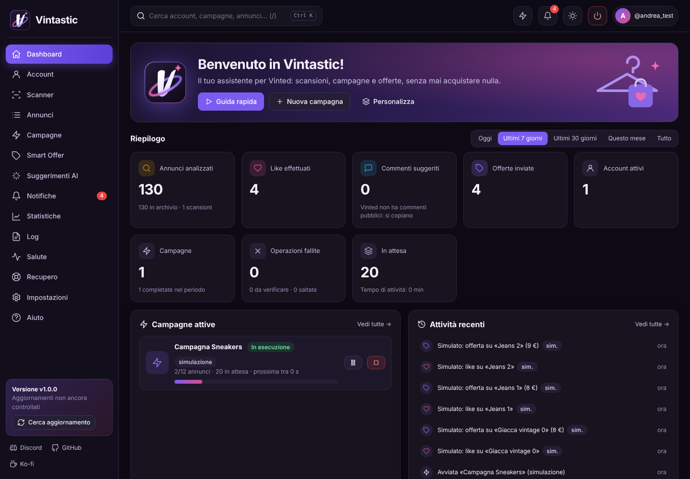
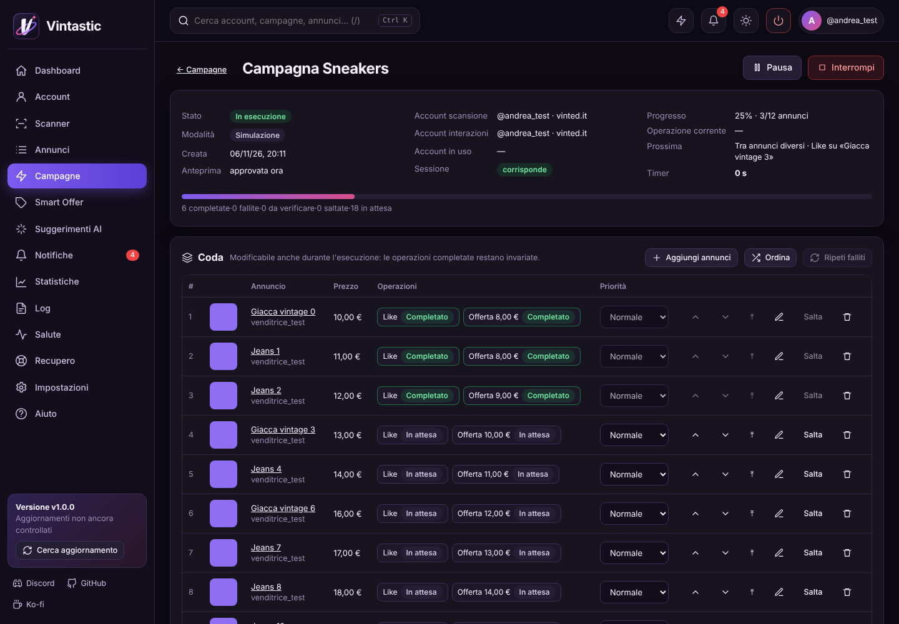
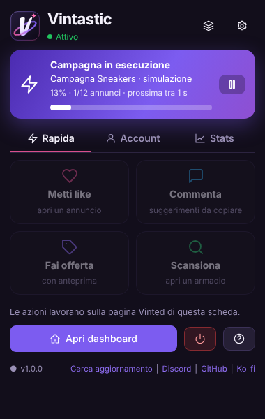
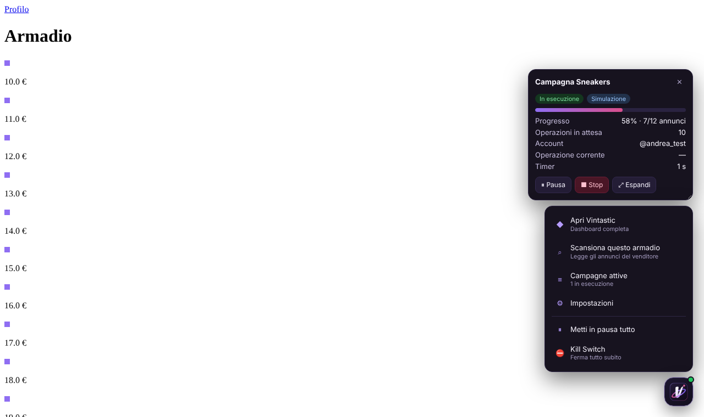

<h1 align="center">Vintastic</h1>

  Assistente per Vinted, per Chrome, Edge e Brave: scanner degli armadi, campagne di like, offerte e messaggi privati con il <b>tuo</b> account, 
  code modificabili mentre girano, Smart Offer Engine, dashboard, diagnostica. <b>Non acquista mai nulla.</b>

  
  
  
  
  
  

---

## Indice

[Cosa fa](#cosa-fa) · [Stato del progetto](#stato-del-progetto) · [Installazione](#installazione) · [Primi passi](#primi-passi) · [Configurazione](#configurazione) · [Aggiornamenti](#aggiornamenti) · [Release](#release) · [Discord](#discord) · [Sicurezza](#sicurezza-e-privacy) · [FAQ](#faq) · [Documentazione](#documentazione) · [Supporto](#supporto) · [Credits](#credits)

## Cosa fa

| | |
|---|---|
| **Scanner degli armadi** | Legge tutti gli annunci di un venditore (paginazione, nessun doppione, aggiornamento dei dati, storico prezzi, annunci ripubblicati collegati). Date separate: pubblicazione, aggiornamento, ripubblicazione, data della foto. Mai inventate. |
| **Filtri e Top N** | Ultimi 5/10/20/50/100 o un numero a scelta, ultime 24 ore / 2, 3, 7, 14, 30 giorni / intervallo, combinabili. Prezzo, stato, venditore, «escludi già fatti». Ordine ribaltabile (più recenti o meno recenti in cima). Filtri salvabili. Vinted non dà la data di pubblicazione: si usa la data della foto (stima) e poi l'ordine dell'armadio. |
| **Campagne** | Like e offerte, singoli o combinati, nell'ordine che scegli; timer configurabili (tra operazioni, tra annunci, tra tipi); conferma facoltativa per ogni offerta; simulazione (Dry Run). |
| **Code dinamiche** | Aggiungi annunci e operazioni, rimuovi, modifica, cambia priorità, riordina (anche casuale, con anteprima) **mentre la campagna gira**. Le operazioni completate non si toccano. Ogni modifica è nello storico. |
| **No Repeat** | Global Interaction Ledger: lo stesso account non ripete lo stesso like o la stessa offerta sullo stesso annuncio, in nessuna campagna. Separato per tipo. |
| **Smart Offer Engine** | Predefinito **+5% sul prezzo**; percentuale ± (sotto o sopra il prezzo), Risparmio / Interazione / Personalizzata, sconti e incrementi in % o €, minimo e massimo, fasce di prezzo, arrotondamenti (,99 · ,00 · multipli di 5 e 10, per eccesso/difetto/vicino), importi casuali. Anteprima sempre. |
| **Suggerimenti AI** | Domande pertinenti all'annuncio (es. giacca → «Potresti indicarmi la misura delle spalle?»), più alternative, tono e lingua, cronologia. Regole locali o LLM (locale o esterno) a scelta. Si copiano: Vinted non ha commenti pubblici. |
| **Mini-widget e FAB** | Sulle pagine Vinted: avanzamento in tempo reale, timer, pausa/riprendi/stop; menu rapido per scansionare l'armadio o aggiungere l'annuncio aperto. |
| **Dashboard** | Statistiche con filtri temporali, grafici, attività in tempo reale, riepilogo code, stato del sistema; widget personalizzabili, tema chiaro/scuro, ricerca globale, comando rapido (Ctrl+K), scorciatoie. |
| **Sicurezza** | Policy Validator prima dell'avvio, Preview Snapshot, soglie giornaliere, Kill Switch globale e per modulo, circuit breaker, pausa su 403/429/CAPTCHA, auto-pausa senza rete, autenticazione assistita. |
| **Affidabilità** | IndexedDB con journal write-ahead: dopo un crash niente viene ripetuto alla cieca (ciò che era in invio diventa «da verificare»). Recovery Center. Migrazioni versionate con rollback. |
| **Diagnostica** | Log filtrabili con possibile soluzione, Health Center con «Esegui controllo completo», Support Bundle senza dati sensibili. |
| **Notifiche** | Centro notifiche con priorità e raggruppamento, notifiche di sistema, badge; pulitore delle notifiche Vinted (solo «segna come letta»). |
| **Aggiornamenti** | «Cerca aggiornamento» su GitHub Releases, download con verifica SHA-256, installazione guidata. Release automatiche con GitHub Actions. |

  

## Stato del progetto

| | |
|---|---|
| Versione | **1.2.0** |
| Browser | Chrome, Edge, Brave (Chromium ≥ 116). Provato in automatico su **Chrome 153**; Edge e Brave non sono stati provati in questo ciclo |
| Verificato su Vinted reale | **No.** Tutto è stato provato su un Vinted finto (vedi [TEST_PLAN](docs/TEST_PLAN.md)). Gli endpoint di like, offerte e notifiche sono ricostruiti, non osservati: alla prima prova vera usa un solo annuncio |
| Dipendenze a runtime | Nessuna. Nessun passaggio di build per usarla |
| Test | 50 unitari + 22 scenari end-to-end in Chrome con l'estensione caricata |

## Installazione

1. Scarica **`Vintastic-x.y.z.zip`** dall'[ultima release](https://github.com/MashaUP/Vintastic/releases/latest) (oppure dalla radice del repository).
2. Estrailo in una **cartella stabile** (non nella cartella temporanea dei download). La cartella giusta è quella che contiene `manifest.json`.
3. Apri `chrome://extensions` (o `edge://extensions`, `brave://extensions`) e attiva **Modalità sviluppatore**.
4. **Carica estensione non pacchettizzata** › scegli la cartella `Vintastic`.
5. Si apre la **guida iniziale**: segui i 9 passi (la prima campagna è una simulazione).
6. Facoltativo: fissa l'icona di Vintastic nella barra del browser.

## Primi passi

1. **Accedi a Vinted** nel browser: Vintastic riconosce l'account da solo (legge solo l'id utente, mai token o password).
2. **Scanner** › incolla l'URL di un armadio (`https://www.vinted.it/member/123…`) › Avvia. Oppure, sull'armadio, pulsante Vintastic › «Scansiona questo armadio».
3. **Annunci** › filtra (es. «Ultimi 20» + «Ultimi 7 giorni») › seleziona › **Aggiungi a campagna**.
4. **Campagne** › apri › **Anteprima e approvazione** (controlli, importi delle offerte) › **Avvia**.
5. Segui l'avanzamento dal widget su Vinted, dal popup o dalla dashboard. Puoi chiudere tutto: la coda continua finché il browser è aperto.

Le nuove campagne partono in **Simulazione**. Per la modalità reale togli la spunta nelle impostazioni della campagna e riapprova l'anteprima.

## Configurazione

Tutto in **Impostazioni** (si salva subito, solo nel tuo browser):

- **Timer**: secondi tra operazioni dello stesso annuncio, tra annunci, tra tipi (like → offerta…), minimo assoluto. Ogni campagna può avere i suoi.
- **Limiti**: soglie giornaliere per like, offerte, commenti, per account e complessive; pause dopo 403/429. *Sono soglie tue, non limiti ufficiali di Vinted.*
- **Notifiche**: categorie, durata, notifiche di sistema.
- **FAB e widget**: attivi, dimensione, posizione.
- **AI**: regole locali (predefinito) o endpoint compatibile OpenAI (Ollama/LM Studio in locale, o un servizio esterno).
- **Discord**: webhook personale facoltativo (Impostazioni › Discord spiega come crearlo).
- **Backup**: esporta/importa JSON con anteprima, scelta delle parti e backup automatico.
- **Dati**: conservazione di log, notifiche, attività.
- **Scorciatoie**: `Alt+Shift+V` dashboard · `Alt+Shift+P` pausa/ripresa · `Alt+Shift+K` Kill Switch (modificabili in `chrome://extensions/shortcuts`). Nella dashboard: `Ctrl+K`, `/`, `Alt+1…9`, `?`.

## Aggiornamenti

1. Popup o dashboard › **Cerca aggiornamento** (anche in automatico ogni 12 ore, disattivabile).
2. **Salute › Scarica e verifica**: lo zip viene scaricato e confrontato con il suo SHA-256; se non coincide non viene salvato.
3. Estrai lo zip **sopra** la cartella attuale (sostituisci i file), poi **Installa**: Vintastic si ricarica e recupera le campagne.

Un'estensione caricata da cartella non può sostituire da sola i propri file: l'estrazione la fai tu. Dal Chrome Web Store l'aggiornamento sarebbe automatico (Vintastic non è sul Web Store).

## Release

Le release sono automatiche: scrivi titolo e descrizione, scegli il tag `vX.Y.Z`, pubblica. GitHub Actions esegue i test, crea `vintastic-X.Y.Z.zip` e il suo `.sha256`, li allega alla release, conserva gli artifact e (se configurato) avvisa su Discord. Dettagli in [RELEASE.md](docs/RELEASE.md).

## Discord

- **Release su Discord**: secret `DISCORD_WEBHOOK_URL` nel repository → notifica a ogni release.
- **Notifiche dall'estensione** (facoltative): il *tuo* webhook, salvato solo nel tuo browser, con permesso concesso da te.
- Community: **[discord.gg/EPsbQCuAkx](https://discord.gg/EPsbQCuAkx)** (il link si aggiorna da `links.json` senza nuove versioni).

## Sicurezza e privacy

- **Divieto assoluto di acquisto**: nessun carrello, checkout o pagamento. Ogni richiesta verso Vinted passa da una lista chiusa (lettura, like, offerta, notifiche); tutto il resto viene bloccato prima di partire. Test dedicati a ogni versione.
- **Nessun aggiramento**: CAPTCHA, verifiche, 403/429 e restrizioni fermano tutto e passano la mano a te.
- **Nessuna credenziale**: Vintastic non legge né salva password, codici, cookie o token (legge solo l'id numerico dell'utente). I token di sessione restano in memoria e non finiscono in log, backup o Support Bundle.
- **Nessun server**: i dati restano nel browser. Uscite solo verso GitHub (aggiornamenti/link) e, se li attivi tu, AI esterna e Discord.

Dettagli: [SECURITY.md](SECURITY.md). Vintastic è un progetto indipendente, non affiliato a Vinted. Usalo rispettando i termini del servizio di Vinted.

## FAQ

<b>Può comprare qualcosa per sbaglio?</b>
No. Non esiste nessun percorso d'acquisto nel codice, e un guard blocca qualsiasi richiesta non in lista prima che parta.

<b>Perché i commenti non vengono inviati?</b>
Vinted non ha commenti pubblici sugli annunci: Vintastic genera i testi, tu li copi e li usi (per esempio in un messaggio).

<b>Funziona con la scheda in secondo piano o il browser chiuso?</b>
In secondo piano sì: Vintastic usa una sua scheda di Vinted, che può restare dietro le altre. A browser chiuso no; alla riapertura la coda si recupera.

<b>Una operazione è «da verificare». Che faccio?</b>
Recupero › controlla su Vinted e indica se è stata eseguita. Per i like c'è la verifica automatica. Non viene mai ripetuta da sola.

<b>Posso usare più account?</b>
Vintastic usa l'account con cui sei collegato a Vinted, riconosce quelli usati in passato e controlla che la sessione corrisponda alla campagna. Il cambio di account si fa su Vinted.

<b>Le soglie giornaliere sono «sicure»?</b>
Sono soglie tue. Vinted non pubblica i suoi limiti, e nessun numero è garantito.

## Documentazione

[Architettura](docs/ARCHITECTURE.md) · [Test](docs/TEST_PLAN.md) · [Release](docs/RELEASE.md) · [Sicurezza](SECURITY.md) · [Changelog](CHANGELOG.md)

## Supporto

- Community e aiuto: **[Discord](https://discord.gg/EPsbQCuAkx)**
- Bug: [apri una segnalazione](https://github.com/MashaUP/Vintastic/issues/new?template=segnalazione-bug.yml) e allega il **Support Bundle** (Log › Support Bundle)
- Se ti è utile: **[Ko-fi](https://ko-fi.com/mashaup)** ☕

## Credits

Progetto di **MashaUP**. Riusa idee e codice dei suoi progetti [Vinted_Relist](https://github.com/MashaUP/Vinted_Relist) (lettura dei token di sessione, gestione 403/429, esiti incerti, version checker, link centralizzati) e Keep_Watching (Health Center, cronologia eventi, statistiche locali). Nessuna libreria di terze parti a runtime. Licenza [MIT](LICENSE).

## Messaggi privati nelle campagne (v1.3.0)

Puoi aggiungere l'operazione **Messaggio privato** alle campagne. Vintastic apre l'annuncio, seleziona **Chiedi info**, compila la chat e verifica la presenza del messaggio inviato. In **Impostazioni → Messaggi** puoi scegliere la modalità automatica (predefinita) oppure la conferma manuale, e configurare il testo. La soglia iniziale è di 10 messaggi al giorno e si può modificare in Impostazioni → Limiti. Se Vinted richiede CAPTCHA/verifiche, la chat non si apre o l'esito non è verificabile, Vintastic non ripete automaticamente l'invio.
